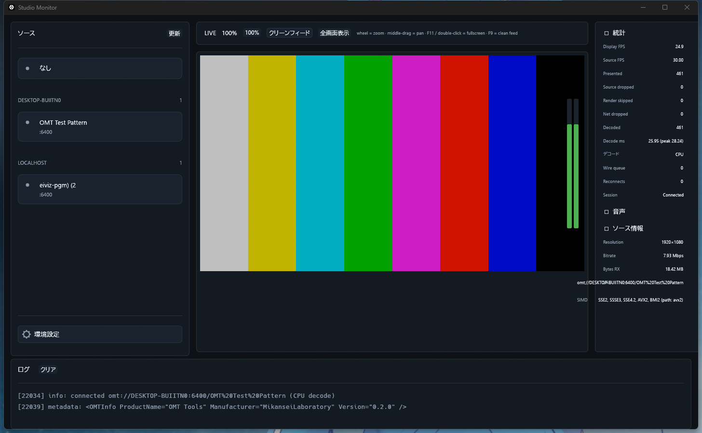

<picture>
  <source media="(prefers-color-scheme: dark)" srcset="assets/branding/omt-community-tools-logo-on-dark.svg">
  
</picture>

# OMT Community Tools

Open Media Transport production utilities for Windows, macOS, and Linux. This is an independent community project and is not affiliated with StudioCoast Pty Ltd or vMix.

## Download

**[Download the latest release](https://github.com/MikanseiLaboratory/omt-community-tools/releases/latest)**

Windows `.msi` / `-setup.exe` · macOS `.dmg` · Linux `.deb` / `.AppImage`

## Tools

| Tool | Description |
|------|-------------|
| Studio Monitor | Discover and view OMT sources. Press `F9` to send a clean feed to a second display. |
| Test Patterns | Send SMPTE-style patterns and tone over OMT. |
| Config Manager | View and edit the global OMT `settings.xml`. |
| Discovery Server | GUI + CLI TCP discovery server (port 6399). |

## Quick start

1. Install and open **OMT Tools**.
2. **Studio Monitor** — pick a source from the list. `F9` opens a clean feed (video only) on another display; configure the display, cursor, and overlays in **Preferences → Clean feed output**.
3. **Test Patterns** — choose a pattern and press **Start** to publish a test source.
4. **Config Manager / Discovery Server** — open them from the launcher.

## Core technology

- **OMT (Open Media Transport)** over the LAN with mDNS discovery
- Native **Rust** tools built with **egui/eframe** + **wgpu**, with VMX and SIMD
- **Tauri** launcher with Windows / macOS / Linux builds

> **First launch:** macOS/Windows may show a security prompt (see [macOS notes](docs/macos-gatekeeper.md)); Linux needs Avahi for discovery and a Vulkan driver.

## License

[PolyForm Shield 1.0.0](LICENSE) — source-available; see the license for terms.
