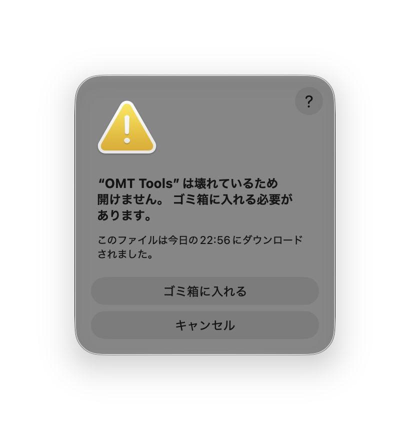
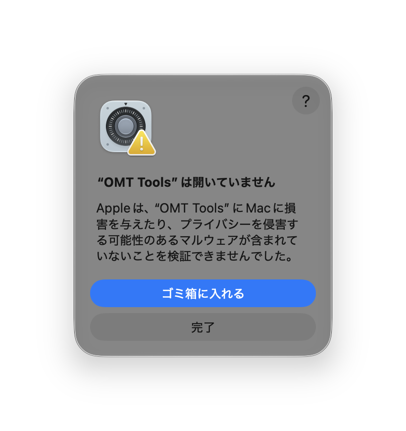
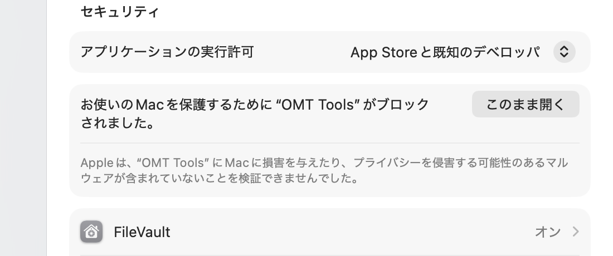

# macOS で「OMT Tools は壊れているため開けません」と表示される場合

Apple Silicon 版の OMT Tools を DMG からインストールして初回起動すると、次のダイアログが表示されて起動できないことがあります。



これはアプリ本体の不具合ではなく、macOS の **Gatekeeper** が配布パッケージの署名を検証できずに起動を止めている状態です。

- v0.1.5 以前の macOS ビルドにはバンドル署名がありません。
- Apple Silicon では、リンカが arm64 の実行ファイルに ad-hoc 署名を自動で付けます。
- そのため「実行ファイルは署名済みなのに、.app バンドルの署名がない」という不整合になり、Gatekeeper が「壊れている」と判定します。
- Intel 版は実行ファイルも未署名のため「未確認の開発元」扱いになり、設定から許可できる場合があります。

> ここで説明する操作は、このリポジトリの Releases からダウンロードした公式ビルドだけを対象にしてください。出所が不明なアプリでは実行しないでください。

## 対処 A: v0.1.5 以前（「壊れている」と表示される場合）

「壊れている」ダイアログには「このまま開く」ボタンがありません。ターミナルで quarantine 属性を外してから起動します。

1. ターミナルを開きます。
2. 次のコマンドを実行します。

   

   ```bash
   xattr -dr com.apple.quarantine "/Applications/OMT Tools.app"
   ```

3. OMT Tools を通常どおり開きます。

アプリを `/Applications` 以外に置いている場合は、パスを実際の場所に置き換えてください。自分でインストールしたアプリなら `sudo` は不要です。

## 対処 B: 次のリリース以降（ad-hoc 署名済み）

次のリリースではビルド時に ad-hoc 署名が付くため、「壊れている」ではなく「未確認の開発元」として扱われます。



1. ダイアログの「完了」をクリックします（「ゴミ箱に入れる」は選ばないでください）。
2. **システム設定 → プライバシーとセキュリティ** を開きます。
3. 下にスクロールし、**セキュリティ** セクションの「このまま開く」をクリックします。

   

4. Touch ID またはパスワードで認証します。
5. 以降は通常どおり起動できます。

## メンテナー向け: 根本的な修正

リリースワークフローは、Apple Developer の証明書がある場合は Developer ID で署名し、notarization まで行います。証明書がない場合は ad-hoc 署名にフォールバックします。ad-hoc 署名は「壊れている」状態を解消しますが notarization ではないため、利用者に一度だけ許可してもらう必要があります。

プロンプトを出さずに配布するには、リポジトリに次の secrets を設定します。

- `APPLE_CERTIFICATE`
- `APPLE_CERTIFICATE_PASSWORD`
- `APPLE_SIGNING_IDENTITY`
- `APPLE_ID`
- `APPLE_PASSWORD`
- `APPLE_TEAM_ID`

詳細は [README の macOS notes](../README.md#macos-notes) を参照してください。
